<p align="center">
  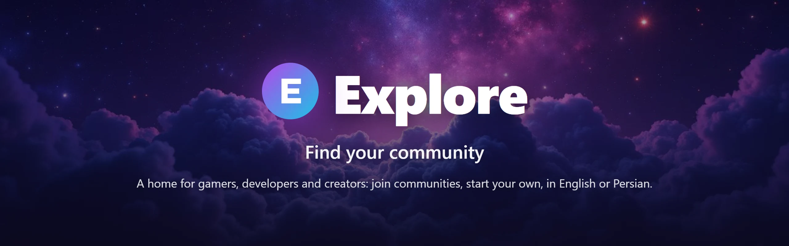
</p>

<p align="center">
  <b>A Discord-style home for gamers, developers and creative teams, made in Iran.</b><br>
  Browse communities, join the ones you love and start your own, in English or Persian, on any device.
</p>

<p align="center">
  
  
  
  
  
  
  
</p>

<p align="center">
  <a href="#-features">Features</a> ·
  <a href="#-screenshots">Screenshots</a> ·
  <a href="#-quick-start">Quick start</a> ·
  <a href="#-how-it-works">How it works</a> ·
  <a href="#-deploy">Deploy</a> ·
  <a href="#-roadmap">Roadmap</a> ·
  <a href="#-contributing">Contributing</a>
</p>

<p align="center">
  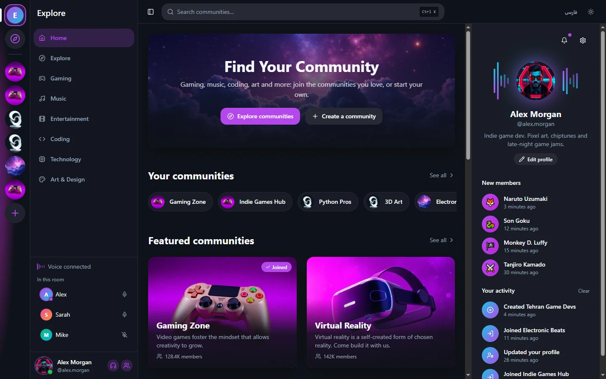
</p>

## 💡 Why Explore?

Explore started as an idea for Iranian gamers, developers and companies: a place like Discord, with a fresh design and first-class support for Persian. It runs on a server inside Iran, so people can reach it **without a VPN**, and everything works in both English and Persian with a proper right-to-left layout.

## ✨ Features

<table>
  <tr>
    <td width="50%" valign="top">
      <h3>🧭 Discover</h3>
      <ul>
        <li>Six categories: Gaming, Music, Entertainment, Coding, Technology, Art &amp; Design</li>
        <li>An <b>Explore</b> page with category filters, a "Joined" filter and sorting</li>
        <li>A page for every community: about, rules, channels and similar communities</li>
        <li>Instant search with <kbd>Ctrl</kbd>+<kbd>K</kbd> or <kbd>/</kbd>, in either language</li>
      </ul>
    </td>
    <td width="50%" valign="top">
      <h3>👥 Accounts and communities</h3>
      <ul>
        <li>Sign up and sign in with email and password; reset or change your password</li>
        <li>Create a community and <b>everyone sees it</b>; delete the ones you made</li>
        <li>Join and leave with one click, saved on the server, on every device</li>
        <li>Your profile: photo, display name, username, bio and phone</li>
      </ul>
    </td>
  </tr>
  <tr>
    <td width="50%" valign="top">
      <h3>🌐 Truly bilingual</h3>
      <ul>
        <li>English and Persian, picked automatically from the browser</li>
        <li>A full right-to-left layout: menus, panels, dialogs, sliders and toasts</li>
        <li>Persian digits, Solar Hijri dates and relative times</li>
        <li>Search that understands Arabic and Persian spelling variants</li>
      </ul>
    </td>
    <td width="50%" valign="top">
      <h3>🎨 Polished and accessible</h3>
      <ul>
        <li>Dark, light and system themes with no flash on load</li>
        <li>Compact mode and an option to turn animations off</li>
        <li>Built for phones, tablets and desktops</li>
        <li>Skip link, clear focus, labelled buttons and forms</li>
      </ul>
    </td>
  </tr>
  <tr>
    <td width="50%" valign="top">
      <h3>🔒 Secure by default</h3>
      <ul>
        <li>Access rules enforced <b>on the server</b>, not just in the browser</li>
        <li>Only a community's creator can change or delete it</li>
        <li>Memberships and contact details are private to their owner</li>
        <li>Rate-limited sign-in, and passwords stored only as hashes</li>
      </ul>
    </td>
    <td width="50%" valign="top">
      <h3>🚀 Ready to host</h3>
      <ul>
        <li>One container serves the site, the API and an admin dashboard</li>
        <li>Ready-made settings for <a href="https://liara.ir">Liara</a>, or any server with Docker</li>
        <li>The font ships with the site: no Google Fonts, fast everywhere</li>
        <li>Sitemap, robots.txt and social link previews generated on build</li>
      </ul>
    </td>
  </tr>
</table>

## 📸 Screenshots

<table>
  <tr>
    <td width="50%">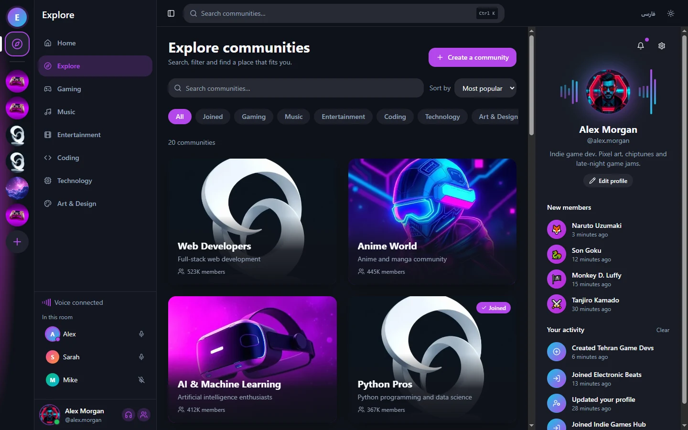</td>
    <td width="50%">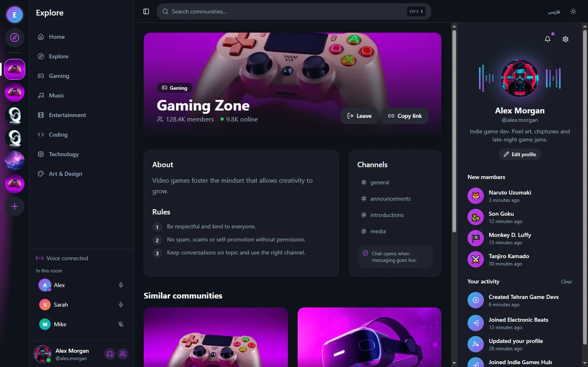</td>
  </tr>
  <tr>
    <td align="center"><b>Explore</b>: filter by category, see what you joined, sort by popularity, date or name</td>
    <td align="center"><b>Community page</b>: about, rules, channels, similar communities</td>
  </tr>
  <tr>
    <td width="50%">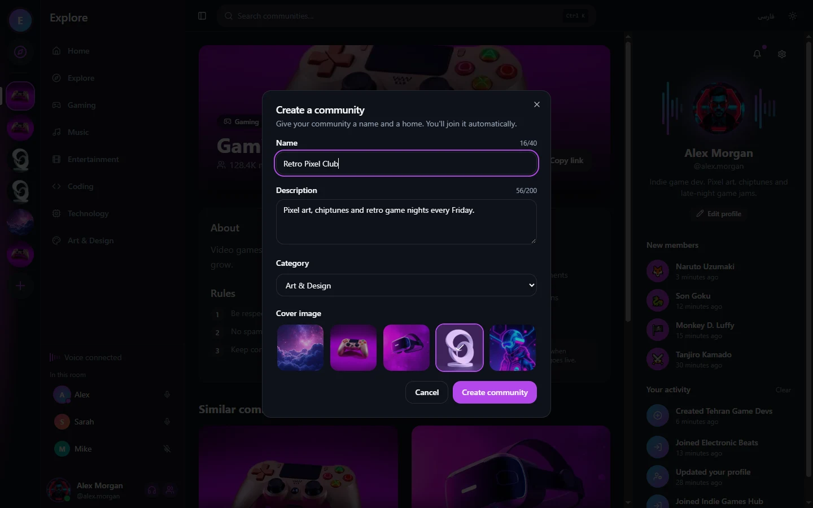</td>
    <td width="50%">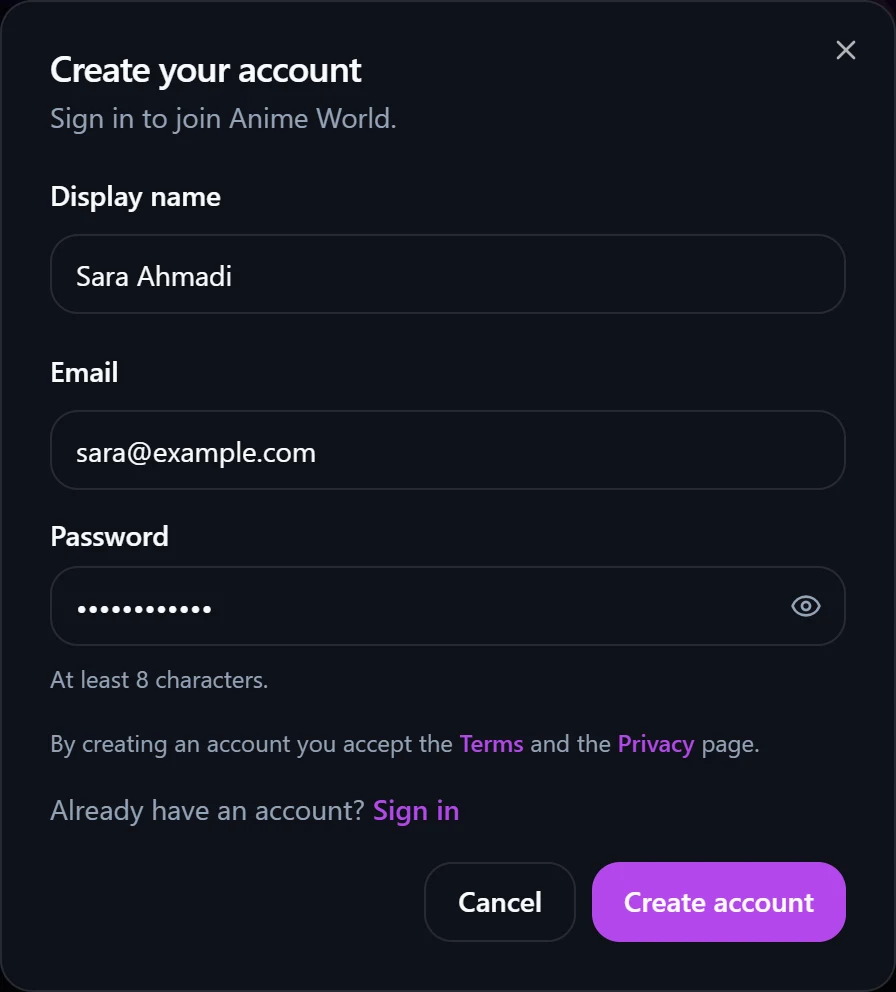</td>
  </tr>
  <tr>
    <td align="center"><b>Create a community</b>: name, description, category and cover</td>
    <td align="center"><b>Sign up</b>: visitors are asked to sign in only when they join or create</td>
  </tr>
  <tr>
    <td width="50%">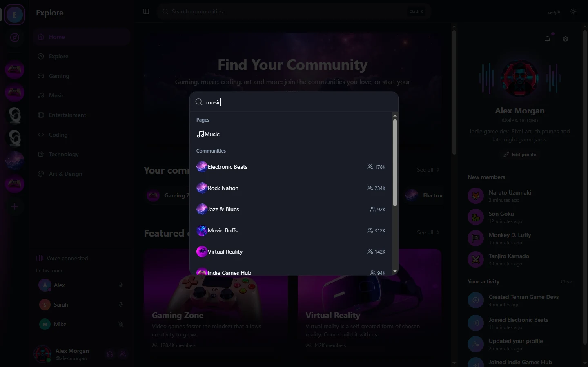</td>
    <td width="50%">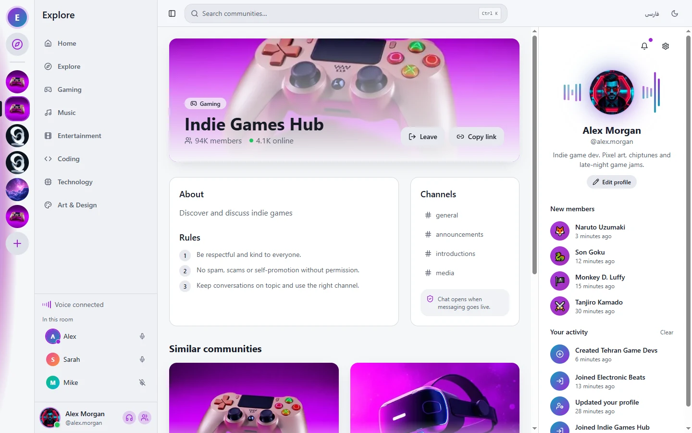</td>
  </tr>
  <tr>
    <td align="center"><b>Search</b>: pages and communities at your fingertips</td>
    <td align="center"><b>Light theme</b>: or dark, or follow the system</td>
  </tr>
</table>

<p align="center">
  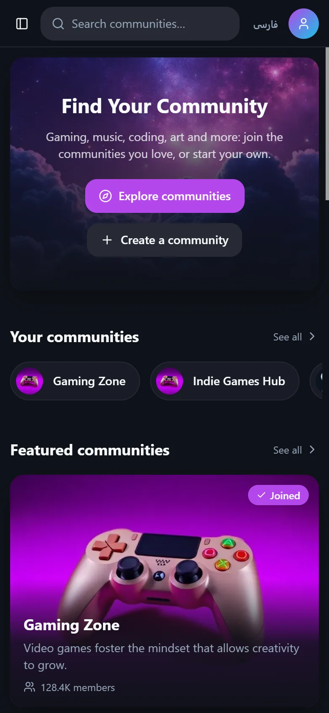
  &nbsp;&nbsp;&nbsp;
  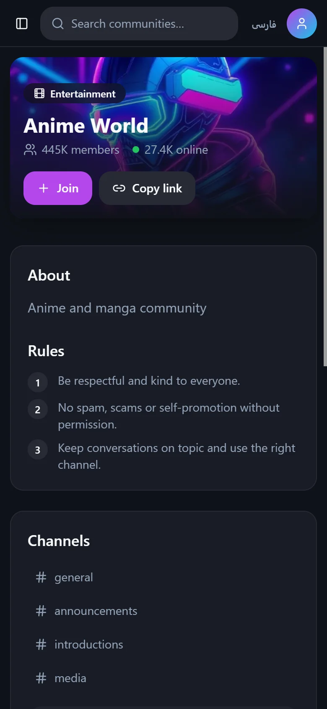
  <br>
  <sub><b>On your phone</b>: every page is designed for small screens too.</sub>
</p>

## ⚡ Quick start

You need [Node.js](https://nodejs.org/) 18 or newer.

```bash
git clone https://github.com/AMIRSTAR1382/instant-web-wizard-44.git
cd instant-web-wizard-44
npm install
```

Start the backend in one terminal. The first run downloads [PocketBase](https://pocketbase.io) from its official release and checks it against the published checksum:

```bash
npm run backend
```

Start the site in a second terminal:

```bash
npm run dev
```

Open **http://localhost:8080**, create an account and try it out. The database lives in `node_modules/.pocketbase/pb_data` and starts with 19 built-in communities.

To open the admin dashboard at http://127.0.0.1:8090/_/, create an admin account first (use your own email and password):

```bash
npm run backend:exec -- superuser upsert you@example.com YOUR_PASSWORD
```

### Scripts

| Command | What it does |
| --- | --- |
| `npm run dev` | The site with hot reload on http://localhost:8080 (forwards `/api` to the backend) |
| `npm run backend` | PocketBase on http://127.0.0.1:8090, with this project's database rules and hooks |
| `npm run build` | Production build into `dist/` |
| `npm run preview` | Serve the production build |
| `npm test` | All automated tests |
| `npm run typecheck` | Strict TypeScript check of the whole project |
| `npm run lint` | ESLint |

## 🧱 How it works

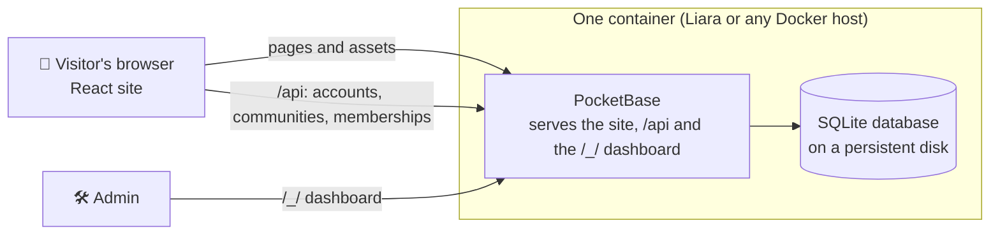

- **The site** is a React single-page app built with Vite. The communities it shows come from the server; it keeps showing the built-in ones (with a "Try again" button) if the server can't be reached.
- **The backend** is [PocketBase](https://pocketbase.io): one small program with accounts, a database and an admin dashboard. The tables, access rules and built-in communities live in [`pocketbase/pb_migrations`](pocketbase/pb_migrations), and server-side logic in [`pocketbase/pb_hooks`](pocketbase/pb_hooks). PocketBase applies them automatically on start.
- **Preferences** (language, theme, sound) stay in the visitor's browser.

### Who can do what

| Data | Read | Create | Change | Delete |
| --- | --- | --- | --- | --- |
| Communities | Everyone, even signed out | Signed-in users | The creator (member counts are server-only) | The creator |
| Memberships | Only your own | Only for yourself | Nobody | Only your own |
| Accounts and profiles | Only your own | Anyone (sign-up) | Only your own | Only your own |

These rules are checked by automated tests against a real PocketBase server.

### Tech stack

| Part | Built with |
| --- | --- |
| Front end | React 18, TypeScript (strict), Vite 5, React Router 6 |
| UI | Tailwind CSS, shadcn/ui (Radix UI), lucide icons, Vazirmatn font |
| Backend | PocketBase 0.40 (Go + SQLite), PocketBase JS SDK |
| Tests | Vitest, Testing Library, jsdom |
| Hosting | Docker; ready-made `liara.json` for Liara |

## ☁️ Deploy

The production image is built by the [`Dockerfile`](Dockerfile): it builds the site, adds PocketBase, and serves everything from one port. On **[Liara](https://liara.ir)** (an Iranian cloud, so visitors need no VPN):

1. Create a **Docker** app and a disk named **`data`** (it keeps the database between deploys).
2. In the app's settings, turn off **zero-downtime deployment**: the database must not be opened by two copies at once.
3. Add the environment variables below (at least `TRUSTED_PROXY_HEADER` and `APP_URL`).
4. Deploy from the project folder:

   ```bash
   npm install -g @liara/cli
   liara login
   liara deploy --app your-app-id
   ```

5. In the app's console, create your admin account:

   ```bash
   /pb/pocketbase superuser upsert you@example.com YOUR_PASSWORD --dir=/pb/pb_data
   ```

6. Add your domain under **Domains**, enable SSL, and set your address in [`src/config/site.ts`](src/config/site.ts).

The complete step-by-step guide (in Persian), including domains, email, backups and running on your own server, is in [DEPLOY.md](DEPLOY.md).

### Environment variables

| Variable | Where | Purpose |
| --- | --- | --- |
| `VITE_API_URL` | Build (`.env`) | Backend address when it is not the site's own address. Leave empty in the normal setup |
| `APP_URL` | Server | The site's address, used in links inside emails |
| `TRUSTED_PROXY_HEADER` | Server | `X-Forwarded-For` behind a proxy, so rate limits apply per visitor |
| `SMTP_HOST`, `SMTP_PORT`, `SMTP_USERNAME`, `SMTP_PASSWORD`, `SMTP_TLS` | Server | Email for password resets and email confirmation |
| `MAIL_SENDER_ADDRESS`, `MAIL_SENDER_NAME` | Server | The "from" address of those emails |

Secrets such as `SMTP_PASSWORD` belong in your hosting panel, never in the repository.

## 🗂️ Project structure

```text
├── src/
│   ├── pages/              one file per page: home, explore, category, community, info, contact, 404
│   ├── components/         layout pieces, cards and dialogs (sign in, create community, edit profile…)
│   ├── context/            shared state: account, profile, communities, preferences, dialogs
│   ├── lib/backend/        the server client (PocketBase) and an in-memory server for tests
│   ├── i18n/               all interface text in English and Persian
│   ├── data/               categories, built-in communities, About / Privacy / Terms text
│   └── config/site.ts      your domain, contact email and social links
├── pocketbase/
│   ├── pb_migrations/      database tables, access rules and built-in communities
│   └── pb_hooks/           member counts, settings from environment variables
├── scripts/pocketbase.mjs  downloads and runs PocketBase for development
├── Dockerfile              the production container
└── liara.json              deploy settings for Liara
```

## 🧪 Testing

```bash
npm test
```

The suite covers translations, Persian search, the built-in communities, page routing, the contact form, right-to-left layout, and the account flows: signing up from the Join button, joining and leaving, creating a community that another browser can see, editing the profile and browsing while the server is down.

To also test the real server's access rules, run the tests while `npm run backend` is running:

```bash
PB_TEST_URL=http://127.0.0.1:8090 npm test
```

## 🗺️ Roadmap

- [x] Communities, categories, search and community pages
- [x] English and Persian with a full right-to-left layout
- [x] Accounts, shared communities and memberships on the server
- [ ] Real-time text chat in channels
- [ ] Voice rooms (WebRTC)
- [ ] Notifications from real activity
- [ ] Delete your own account from the settings
- [ ] Sign in with an SMS code
- [ ] Installable app (PWA)

## 🤝 Contributing

Explore is an open project, and help is very welcome. If you'd like to build the next generation of the web together, open an [issue](https://github.com/AMIRSTAR1382/instant-web-wizard-44/issues) or send a pull request.

1. Fork the repository and create a branch.
2. Make your change, with tests where it makes sense.
3. Run `npm test`, `npm run typecheck` and `npm run lint`.
4. Open a pull request describing what changed and why.

Interface text lives in `src/i18n/en.ts` and `src/i18n/fa.ts`: every new string needs both, and a test checks that they match.

## 📄 License

No license has been chosen yet. Until one is added, please open an issue before reusing the code.

---

<p align="center">Made with 💜 in Iran, by <a href="https://github.com/AMIRSTAR1382">AMIRSTAR1382</a> and contributors.</p>
